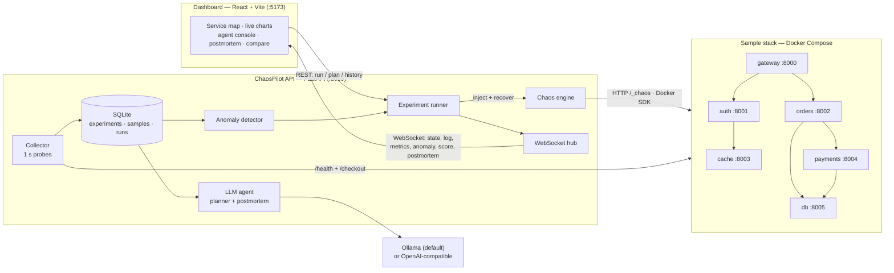

# ChaosPilot

**An AI agent that breaks a microservice stack on purpose, notices when it
misbehaves, and explains why — with fix suggestions grounded in the telemetry it
collected.**

ChaosPilot is a self-contained chaos-engineering lab: a small Docker Compose
stack, a 1-second telemetry collector, an Isolation Forest anomaly detector, a
FastAPI backend that runs experiments and an LLM agent that plans experiments
and writes postmortems. A React HUD streams the whole run live over WebSocket.

```text
inject a fault  ->  collect telemetry  ->  detect the anomaly  ->  explain + suggest fixes
```

## Demo

> **Screenshot / GIF placeholder.** Drop a screen recording of a full run at
> `docs/screenshots/dashboard.gif` and replace this block with:
>
> ```markdown
> 
> ```
>
> See [`docs/screenshots/README.md`](docs/screenshots/README.md) for a suggested
> capture sequence. Until then, the dashboard can be explored without Docker or
> a backend at `http://localhost:5173/?mock=1`.

## Architecture



The full component/data-flow documentation lives in
[`docs/ARCHITECTURE.md`](docs/ARCHITECTURE.md).

## Tech stack

| Layer | Technology |
| --- | --- |
| Backend API | FastAPI, Uvicorn, Pydantic v2 |
| Persistence | SQLite (stdlib `sqlite3`, WAL mode) |
| Anomaly detection | scikit-learn `IsolationForest`, NumPy, joblib |
| Chaos / containers | Docker SDK for Python, Docker Compose v2 |
| LLM | Ollama by default; any OpenAI-compatible API |
| Frontend | React 18, Vite 6, TypeScript 5.7 |
| Styling | Tailwind CSS 3.4 |
| Topology graph | `@xyflow/react` (React Flow) 12 |
| Charts | Recharts 2.15 |
| Client state | Zustand 5 |
| Tooling | pytest, Ruff, pre-commit, gitleaks |
| Runtime | Python 3.11, Node.js 18+ (Node 24 tested) |

## Run it in 3 commands

Requirements: Docker with Compose v2, Python 3.11 and Node.js 18+.

```bash
# 1. Clone
git clone https://github.com/Anos-Voldigoad-8/chaospilot.git && cd chaospilot

# 2. Start everything: stack + API + dashboard
./run_demo.sh          # Windows: powershell -ExecutionPolicy Bypass -File .\run_demo.ps1

# 3. Open the dashboard
open http://localhost:5173    # Linux: xdg-open, Windows: Start-Process http://localhost:5173
```

`run_demo.sh` / `run_demo.ps1` create `.env` from `.env.example` when it is
missing, install backend and frontend dependencies, start the six-service sample
stack, wait for health, then launch the API on `127.0.0.1:8090` and the
dashboard on `localhost:5173`.

No Docker? Start the backend and frontend manually and use the scripted feed:

```bash
cd backend && uvicorn app:app --reload --port 8090   # terminal 1
cd frontend && npm install && npm run dev            # terminal 2
# then open http://localhost:5173/?mock=1
```

Manual setup, configuration and troubleshooting are in
[`docs/OPERATIONS.md`](docs/OPERATIONS.md).

## How a chaos experiment works

1. **Request.** The dashboard posts `{"fault", "target", "fixes"}` to
   `POST /experiments/run`, or `POST /agent/plan` lets the agent choose the
   experiment itself. Only one experiment can run at a time.
2. **Optional fixes.** With `fixes: true`, the stack is recreated through
   `docker compose up` with `RESILIENT=true` (1 retry, 1 s timeout, circuit
   breaker and fallback responses) before the baseline starts.
3. **Baseline (10 s).** The collector probes `/health` on all six services and
   performs a synthetic `/checkout` through the gateway once per second. The
   median latency per service becomes the baseline.
4. **Fault (20 s).** The chaos engine injects `latency` or `memory` through the
   target's `/_chaos/*` endpoints, or `kill` through the Docker SDK. Labels mark
   the samples that belong to the fault window.
5. **Live scoring.** Every tick emits `state`, `metrics`, `anomaly` and `score`
   events. The anomaly score comes from the Phase 5 Isolation Forest when the
   model artifact exists, with a baseline-ratio heuristic as fallback.
6. **Recovery (10 s).** Faults are reset, containers restored and the recovery
   window is collected.
7. **Report.** The final score uses the worst status each service reached during
   the fault window. The agent receives topology, status timeline, anomaly
   scores and phase statistics, then streams a `postmortem` (`llm` or
   `template`) and the run is stored in SQLite.

Resilience score:

```text
score = 100
      - 15 * failed services
      -  6 * degraded services
      + 10 if fixes were enabled and the blast radius stayed contained
```

`bad` means a service was down or a request errored; `warn` means latency was
more than 3x its baseline median; everything else is `ok`. Containment means no
service outside the target's blast radius (the target plus its transitive
callers) failed or degraded.

## ML model

The detector is an **Isolation Forest** trained only on healthy windows. Every
number below is read from [`docs/model_metrics.json`](docs/model_metrics.json).

| Item | Value |
| --- | --- |
| Model | `IsolationForest` (scikit-learn 1.9.1) |
| Parameters | `n_estimators=200`, `contamination=0.02`, `random_state=42` |
| Dataset | 6,480 samples from 24 experiments, `source: simulated` |
| Windows | 5,604 total; train 2,634 / validation 1,362 / test 1,368 |
| Feature vector | 10 features: 5 service + 5 aggregated dependency features |
| Calibration | center `0.0`, scale `0.05221` |
| Decision threshold | `0.5719` (chosen on validation F1) |

Held-out test results:

| Metric | Validation | Test |
| --- | --- | --- |
| Precision | 0.9560 | 0.9774 |
| Recall | 0.9667 | 0.9611 |
| F1 | 0.9613 | 0.9692 |
| Accuracy | 0.9897 | 0.9920 |
| Specificity | 0.9932 | 0.9966 |

Test confusion matrix (`normal` / `fault`): TN 1,184, FP 4, FN 7, TP 173.

Per-fault test recall: `kill` 1.0000 (54/54), `latency` 0.9444 (68/72),
`memory` 0.9444 (51/54).

Features per 5-second window: `latency_mean`, `latency_max`, `error_rate`,
`up_ratio`, `latency_slope`, plus aggregated dependency `dep_latency_mean`,
`dep_latency_max`, `dep_error_rate`, `dep_up_ratio`, `dep_latency_slope`.

Regenerate the dataset and retrain from `backend/`:

```bash
python -m ml.scripts.generate_dataset --source auto
python -m ml.train
```

Artifacts: [`docs/model_metrics.json`](docs/model_metrics.json),
[`docs/confusion_matrix.png`](docs/confusion_matrix.png) and the git-ignored
model at `backend/models/isolation_forest.joblib`. The pipeline is documented in
[`backend/ml/README.md`](backend/ml/README.md).

## Limitations

- **It is a lab, not a production chaos platform.** Six toy FastAPI services
  with in-memory state, one host, one SQLite file.
- **The published model was trained on simulated telemetry.** The metrics file
  says `source: simulated`; regenerate with `--source stack` before trusting
  absolute scores.
- **The point estimates are optimistic.** Adjacent one-second windows overlap,
  so validation and test windows are not fully independent.
- **The stack exposes limited signals.** Only health and checkout
  latency/error are collected — no error classes, restart counts or container
  resource pressure.
- **`kill` needs Docker.** Latency and memory faults are applied over HTTP and
  still work without a Docker daemon.
- **The LLM is optional.** If Ollama or the hosted provider is unreachable, the
  deterministic template still produces a postmortem.
- **No authentication.** The API and dashboard are intended for local use only.
- **One experiment at a time.** A second request returns `409` while a run is
  active.

## Future work

- Re-generate the dataset and evaluate the model on the real Compose stack.
- Evaluate on non-overlapping windows and report confidence intervals.
- Add richer telemetry: container CPU/memory, restart counts, structured logs.
- Add faults beyond `kill` / `latency` / `memory` (error injection, CPU
  pressure, network partitions).
- Persist trends across runs and compare more than one fixes-off/fixes-on pair.
- Add CI for pytest, Ruff, `npm run build` and gitleaks; publish signed images.
- Harden the API with authentication and move beyond a single-process SQLite
  writer if the lab grows.

## Documentation

- [Architecture and data flow](docs/ARCHITECTURE.md)
- [Phase plan](docs/PHASES.md)
- [API reference](docs/API.md)
- [Local operations](docs/OPERATIONS.md)
- [Security policy](docs/SECURITY.md)
- [Report notes (module summaries)](docs/REPORT_NOTES.md)
- [Anomaly model pipeline](backend/ml/README.md)
- [Agent planner and postmortem](backend/agent/README.md)

## Security — read before contributing

> **This repository is public. Never commit credentials.**
>
> 1. Copy `.env.example` to `.env` and fill in your own values. `.env` is
>    git-ignored and must never appear in `git status`.
> 2. All backend configuration/secrets are loaded from environment variables
>    with `python-dotenv` and `pydantic-settings`. There are no hardcoded keys.
> 3. The frontend only receives non-secret `VITE_*` values. **LLM API keys
>    never enter the browser**; every LLM call is made by the backend.
> 4. `docker-compose.yml` uses `env_file` / `${VAR}` references only.
> 5. A **gitleaks** pre-commit hook blocks commits containing secrets. Install
>    it once with `pre-commit install`. Do not use `git commit --no-verify`.

Verify `.env` is ignored:

```bash
git check-ignore -v .env
```

See [docs/SECURITY.md](docs/SECURITY.md) for the full policy.

## License

MIT — see [`LICENSE`](LICENSE).
