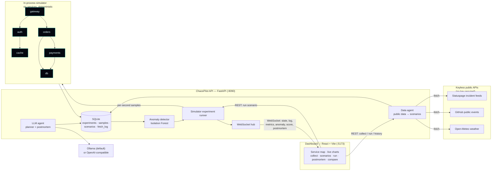

# ChaosPilot

**An AI agent that turns real-world incidents into chaos scenarios, runs them
in a deterministic in-process simulator, detects the anomaly with an Isolation
Forest, and explains why — with fix suggestions grounded in the telemetry it
collected.**

ChaosPilot is a self-contained chaos-engineering lab: a backend data agent that
pulls real outage and traffic data from keyless public APIs, an in-process
simulator of six microservices, an Isolation Forest anomaly detector, a FastAPI
backend that runs experiments and an LLM agent that writes postmortems. A React
HUD streams the whole run live over WebSocket.

```text
internet data  ->  data agent  ->  scenarios  ->  simulator  ->  anomaly model  ->  UI
```

There is **no Docker** — the microservices are simulated in-process, so the lab
runs on a laptop with zero infrastructure.

## Demo

> **Screenshot / GIF placeholder.** Drop a screen recording of a full run at
> `docs/screenshots/dashboard.gif` and replace this block with:
>
> ```markdown
> 
> ```
>
> See [`docs/screenshots/README.md`](docs/screenshots/README.md) for a suggested
> capture sequence. Until then, the dashboard can be explored without a backend
> at `http://localhost:5173/?mock=1`.

## Architecture



The full component/data-flow documentation lives in
[`docs/ARCHITECTURE.md`](docs/ARCHITECTURE.md).

## Tech stack

| Layer | Technology |
| --- | --- |
| Backend API | FastAPI, Uvicorn, Pydantic v2 |
| Persistence | SQLite (stdlib `sqlite3`, WAL mode) |
| Simulator | in-process Python (`backend/sim`), deterministic with a seed |
| Chaos faults | `kill`, `latency`, `memory` (simulated; no Docker) |
| Anomaly detection | scikit-learn `IsolationForest`, NumPy, joblib |
| Data collection | httpx (10s timeout, 3 retries + backoff, User-Agent) |
| LLM | Ollama by default; any OpenAI-compatible API (backend only) |
| Frontend | React 18, Vite 6, TypeScript 5.7 |
| Styling | Tailwind CSS 3.4 |
| Topology graph | `@xyflow/react` (React Flow) 12 |
| Charts | Recharts 2.15 |
| Client state | Zustand 5 |
| Tooling | pytest, Ruff, pre-commit, gitleaks |
| Runtime | Python 3.11+, Node.js 20+ |

## Run it in 3 commands

Requirements: Python 3.11+ and Node.js 20+. **No Docker required.**

```bash
# 1. Clone
git clone https://github.com/Anos-Voldigoad-8/chaospilot.git && cd chaospilot

# 2. Start everything: API + dashboard (builds seed data + model if missing)
./run_demo.sh          # Windows: powershell -ExecutionPolicy Bypass -File .\run_demo.ps1

# 3. Open the dashboard
open http://localhost:5173    # Linux: xdg-open, Windows: Start-Process http://localhost:5173
```

`run_demo.sh` / `run_demo.ps1` create `.env` from `.env.example` when it is
missing, install backend and frontend dependencies, build the committed seed
dataset and train the anomaly model if they are absent, then launch the API on
`127.0.0.1:8090` and the dashboard on `localhost:5173`. The app works with zero
internet because the seed data and model are committed.

Manual setup:

```bash
# backend (terminal 1)
cd backend && python -m venv .venv && .venv/Scripts/python -m pip install -r requirements.txt
python scripts/build_seed.py          # builds seed data + trains the model (offline)
.venv/Scripts/python -m uvicorn app:app --reload --port 8090

# frontend (terminal 2)
cd frontend && npm install && npm run dev
# then open http://localhost:5173
```

Or try the scripted feed without a backend: `http://localhost:5173/?mock=1`

## How it works

1. **Collect data.** The dashboard clicks **COLLECT DATA**, which calls
   `POST /agent/collect`. The backend data agent fetches real outage and
   traffic from keyless public APIs (Statuspage incident feeds, GitHub public
   events, Open-Meteo weather), converts them into **scenarios** and persists
   them to SQLite. Progress streams over WebSocket. If the network is down it
   falls back to cached responses, then to the committed seed dataset — the app
   never crashes and `/scenarios` is never empty.
2. **Choose a scenario.** `GET /scenarios` returns each scenario with its title,
   source, target service, severity, a **Data source** badge (LIVE / CACHED /
   SEED) and the real source URL. The dashboard lets the operator pick one.
3. **Run.** `POST /experiments/run {scenario_id, fixes}` runs **only** an
   agent-stored scenario — there is no hardcoded or manual fault selection.
   The simulator replays baseline → fault → recovery for all six services, and
   a fault on one service raises latency/errors upstream.
4. **Resilience.** With `fixes` (resilient) on, retry, timeout and circuit
   breaker contain the blast radius to one hop, earning a containment bonus.
5. **Detect + explain.** The Isolation Forest scores anomaly windows; a
   postmortem generator uses the real incident title and source to explain the
   failure and suggest fixes. The run is stored in SQLite with its score and
   phases.

Resilience score:

```text
score = 100
      - 15 * failed services
      -  6 * degraded services
      + 10 if fixes were enabled and the blast radius stayed contained
```

`bad` means a service was down or a request errored; `warn` means latency was
more than 3x its baseline median; everything else is `ok`. Containment means no
service outside the target's one-hop blast radius failed or degraded.

## ML model

The detector is an **Isolation Forest** trained only on healthy windows from
`metrics_seed.csv`. Every number below is read from
[`docs/model_metrics.json`](docs/model_metrics.json):

| Metric | Test value |
| --- | --- |
| Precision | 0.9412 |
| Recall | 0.6809 |
| F1 | 0.7901 |
| Trained windows | 4,574 |

Confusion matrix (normal / fault): TN 1,768, FP 4, FN 30, TP 64.

If the model file (`backend/models/isolation_forest.joblib`) is missing at
startup, the backend retrains it automatically.

Regenerate the dataset and retrain:

```bash
python scripts/build_seed.py
```

Artifacts: [`docs/model_metrics.json`](docs/model_metrics.json) and the
git-ignored model at `backend/models/isolation_forest.joblib`. The pipeline is
documented in [`backend/ml/README.md`](backend/ml/README.md).

## Limitations

- **It is a lab, not a production chaos platform.** Six simulated services with
  deterministic telemetry, one host, one SQLite file.
- **The published model was trained on simulated telemetry.** Regenerate with
  `python scripts/build_seed.py` before trusting absolute scores.
- **The point estimates are optimistic.** Adjacent one-second windows overlap,
  so validation and test windows are not fully independent.
- **No Docker.** All faults are simulated in-process; the simulator is
  deterministic given a seed.
- **The LLM is optional.** If Ollama or the hosted provider is unreachable,
  source-picking falls back to a seeded random choice and the postmortem falls
  back to a template.
- **No authentication.** The API and dashboard are intended for local use only.
- **One experiment at a time.** A second request returns `409` while a run is
  active.

## Future work

- Re-generate the dataset and evaluate on non-overlapping windows with confidence
  intervals.
- Add richer simulated telemetry: restart counts, structured logs, CPU pressure.
- Persist trends across runs and compare more than one fixes-off/fixes-on pair.
- Add CI for pytest, Ruff, `npm run build` and gitleaks.
- Harden the API with authentication if the lab grows.

## Documentation

- [Architecture and data flow](docs/ARCHITECTURE.md)
- [Phase plan](docs/PHASES.md)
- [API reference](docs/API.md)
- [Local operations](docs/OPERATIONS.md)
- [Security policy](docs/SECURITY.md)
- [Report notes (module summaries)](docs/REPORT_NOTES.md)
- [Anomaly model pipeline](backend/ml/README.md)
- [Agent planner and postmortem](backend/agent/README.md)

## Security — read before contributing

> **This repository is public. Never commit credentials.**
>
> 1. Copy `.env.example` to `.env` and fill in your own values. `.env` is
>    git-ignored and must never appear in `git status`.
> 2. All backend configuration/secrets are loaded from environment variables
>    with `python-dotenv` and `pydantic-settings`. There are no hardcoded keys.
> 3. The frontend only receives non-secret `VITE_*` values. **LLM API keys
>    never enter the browser**; every LLM call is made by the backend.
> 4. A **gitleaks** pre-commit hook blocks commits containing secrets. Install
>    it once with `pre-commit install`. Do not use `git commit --no-verify`.
> 5. No Docker Compose or sample-stack credentials exist in this repository;
>    chaos faults are simulated in-process.

Verify `.env` is ignored:

```bash
git check-ignore -v .env
```

See [docs/SECURITY.md](docs/SECURITY.md) for the full policy.

## License

MIT — see [`LICENSE`](LICENSE).
