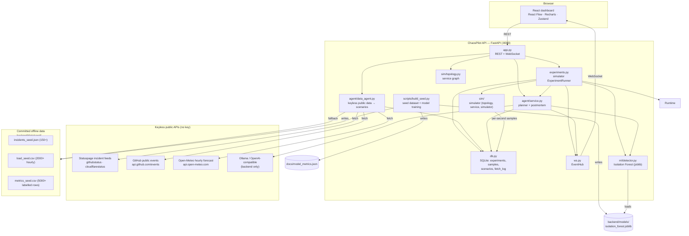
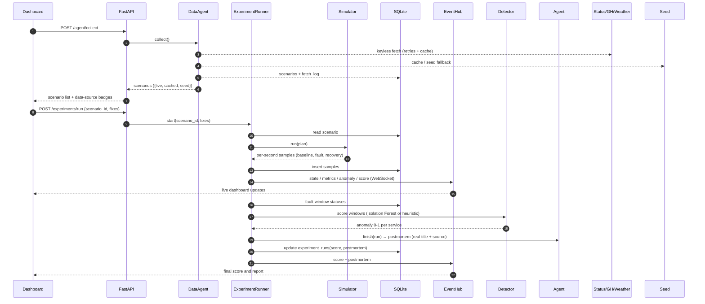

# Architecture

ChaosPilot is four cooperating subsystems around one SQLite database. All
privileged work (ML, LLM, network fetches) happens in the backend; the browser
is a read-mostly dashboard. There is **no Docker**: the microservices are an
in-process, deterministic simulator under `backend/sim/`.

Data flows: **internet data → data agent → scenarios → simulator → anomaly
model → UI**.

## 1. Components



## 2. Data flow

### Phase A — Collect real-world data (POST /agent/collect)

The data agent fetches real outage and traffic data from keyless public APIs:

* Statuspage incident feeds (`/api/v2/incidents.json` on githubstatus.com,
  cloudflarestatus.com and similar) → real outage records.
* GitHub public events → real traffic-shaped activity (replacement for the now
  dead Wikimedia pageviews API).
* Open-Meteo hourly forecast → a second load signal (weather).

The LLM (Ollama or the configured API) picks which sources to query, validated
with pydantic. If the LLM fails twice, a seeded random picker is used. Every
raw response is cached in `backend/data/cache/`; on failure the agent falls back
to cache, then to the committed seed dataset. The agent logs which source it
used (`live`, `cached` or `seed`). Each source is converted into one or more
**scenarios**: a fault type, target service (keyword-mapped from the real
incident's component name to one of the six simulated services), duration,
severity and a normalized load curve. Scenarios and a fetch log are persisted
to SQLite (`scenarios` table, `fetch_log` table).

### Phase B — Run a simulator experiment (POST /experiments/run)

An experiment can **only** run a scenario stored by the agent. The runner:

1. Reads the scenario (fault type, target service, duration, load curve).
2. Runs the in-process simulator: baseline → fault → recovery, producing
   per-second telemetry (`up`, `latency_ms`, `error_rate`) for all six
   services. Deterministic given a seed.
3. A fault on one service raises latency/errors for itself and every caller
   upstream (gateway→auth/orders, auth→cache, orders→payments/db,
   payments→db).
4. The `fixes` (resilient) flag simulates retry, timeout and circuit breaker,
   containing the blast radius to one hop.

Samples are written to SQLite and broadcast over WebSocket as `state`,
`metrics`, `anomaly` and `score` events.

### Phase C — Detect anomalies

The Isolation Forest (trained on healthy windows only from `metrics_seed.csv`)
scores 5-second feature windows. The model is saved with joblib and
`docs/model_metrics.json` records precision, recall, F1 and the confusion
matrix. If the model file is missing at startup, it retrains automatically. A
statistical fallback keeps scoring if the model is unavailable.

### Phase D — Explain (postmortem)

The postmortem generator uses the real incident title and source from the
scenario, plus anomaly context, recent metrics and the fault timeline, to
produce a grounded diagnosis and fix suggestions (LLM or deterministic template).

## 3. Experiment sequence



## 4. Backend modules

| Module | Responsibility |
| --- | --- |
| `backend/app.py` | FastAPI app: `/health`, `/topology`, `/scenarios`, `/agent/collect`, `/experiments/run`, `/experiments`, `/ws` |
| `backend/api_config.py` | Env-driven settings: DB path, phase lengths, CORS |
| `backend/sim/topology.py` | Six-service dependency graph (gateway→auth/orders→payments/db, etc.) |
| `backend/sim/service.py` | Per-service baseline sampling and fault application (kill/latency/memory) |
| `backend/sim/simulator.py` | Deterministic experiment: baseline → fault → recovery; resilient one-hop containment |
| `backend/db.py` | SQLite schema: experiments, samples, scenarios, fetch_log |
| `backend/experiments.py` | Background run lifecycle, live events, resilience score, postmortem |
| `backend/runtime.py` | Status derivation, resilience formula, phase stats, postmortem text |
| `backend/ws.py` | WebSocket fan-out with stale-client cleanup |
| `backend/agent/data_agent.py` | Collects keyless public data → scenarios; cache/seed fallback |
| `backend/agent/*` | Planner, postmortem writer, LLM plumbing |
| `backend/ml/*` | Feature windows, Isolation Forest training, evaluation, detector |
| `scripts/build_seed.py` | Builds committed seed dataset + trains model → `docs/model_metrics.json` |

The earlier `backend/core/` scaffold and `backend/chaos/` (Docker) engine are
no longer used by the served API.

## 5. Data model

```sql
experiments(id, fault_type, target_service, started, ended, fixes_on)

samples(id, experiment_id, ts, service, up, latency_ms, error, label)
-- label = 1 inside the fault window, 0 otherwise

experiment_runs(
    experiment_id, status, resilient,
    baseline_end, fault_started, fault_ended, recovery_end,
    score, postmortem, error
)

scenarios(
    id, fault_type, target_service, duration_minutes, severity,
    load_curve, source, source_url, data_source, title, created_at
)

fetch_log(id, url, status, rows, timestamp)
```

`samples` is append-only. Timestamps are Unix seconds (UTC). SQLite runs in WAL
mode; one experiment writes at a time.

## 6. Event contract

| Event | Payload |
| --- | --- |
| `state` | `service`, `status` (`ok`/`warn`/`bad`), `latency_ms` |
| `log` | `level`, `text` (collection, experiment, agent steps, errors) |
| `metrics` | `gateway_latency`, `error_rate` |
| `anomaly` | `value` (0-1), `services` map |
| `score` | `value`, `failed[]`, `degraded[]`, `contained`, `bonus` |
| `postmortem` | `text`, `source` (`llm`/`template`), `structured` |

## 7. Scoring and status rules

| Status | Rule |
| --- | --- |
| `bad` | service is down or the request errored |
| `warn` | latency is more than 3x the baseline median |
| `ok` | everything else |

```text
score = 100 - 15 * failed - 6 * degraded + (10 if fixes and contained else 0)
```

With `fixes=true` (resilient), the blast radius is contained to one hop — only
the target and its direct callers can fail or degrade — so services outside
that radius stay `ok` and earn the containment bonus.

## 8. Failure modes and design choices

- **No Docker**: faults are simulated in-process; the simulator is deterministic
  given a seed.
- **Network down**: `/agent/collect` falls back to cached responses, then the
  committed seed dataset; the app never crashes and `/scenarios` is never empty.
- **LLM unavailable**: source picking falls back to a seeded random picker;
  postmortem falls back to a template.
- **Model artifact missing**: the runner falls back to a heuristic anomaly
  score and retrains the model automatically at startup.
- **Public repository**: env-only configuration, gitleaks plus a local guard,
  and a backend-only LLM boundary are architectural requirements. No secrets in
  code or the frontend.
- **Frontend offline**: the dashboard shows a backend-unreachable banner and
  supports `?mock=1` for a scripted demo without a server.
