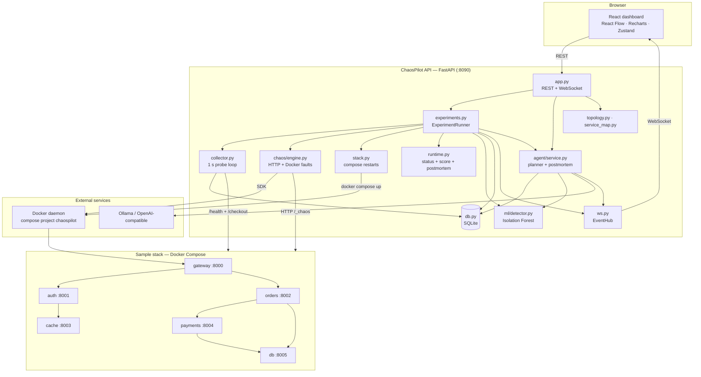
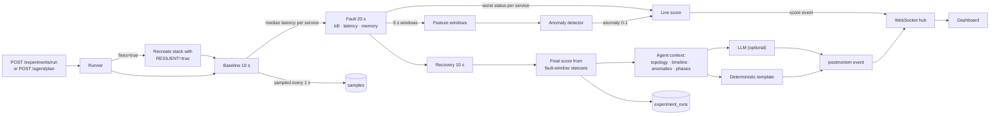
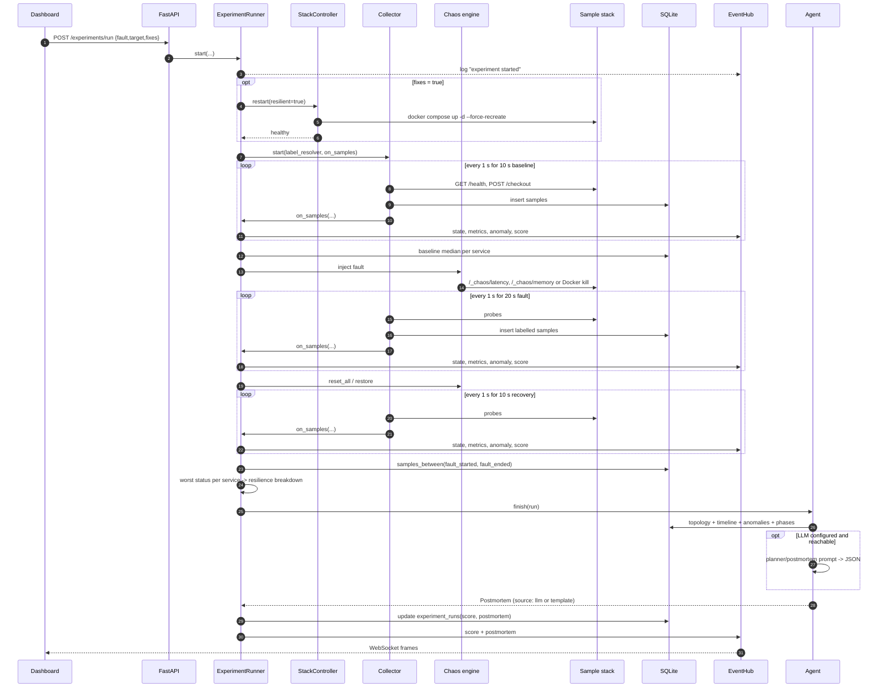

# Architecture

ChaosPilot is four cooperating subsystems around one SQLite database. All
privileged work (Docker, ML, LLM) happens in the backend; the browser is a
read-mostly dashboard with explicit run and plan actions.

## 1. Components



## 2. Data flow

The live experiment path is a single loop: the collector writes samples, the
runner turns them into events, the agent turns the stored evidence into a
report.



## 3. Experiment sequence



## 4. Backend modules

| Module | Responsibility |
| --- | --- |
| `backend/app.py` | FastAPI app: `/health`, `/topology`, `/experiments`, `/agent`, `/ws`, CORS, lifespan |
| `backend/api_config.py` | Env-driven settings: DB path, phase lengths, latency, memory, CORS |
| `backend/topology.py` | Static six-service graph and dependency edges |
| `backend/service_map.py` | Canonical service names and host ports 8000-8005 |
| `backend/stack.py` | Compose restarts with `RESILIENT=true|false`, health waits |
| `backend/experiments.py` | Background run lifecycle, live events, final score |
| `backend/collector.py` | 1 s probing of every service plus a gateway checkout |
| `backend/db.py` | SQLite schema and queries for experiments, samples and runs |
| `backend/runtime.py` | Status derivation, resilience formula, phase stats, postmortem text |
| `backend/ws.py` | WebSocket fan-out with stale-client cleanup |
| `backend/chaos/engine.py` | HTTP `/_chaos` faults plus Docker `kill`/`restore` |
| `backend/ml/*` | Feature windows, dataset generation, training, evaluation, detector |
| `backend/agent/*` | Tools, planner, postmortem writer, LLM plumbing, context builder |

The earlier `backend/core/` scaffold is still imported for typed settings
(`core/config.py`) and the shared LLM client (`core/agent/llm.py`). Its API
routers are **not** mounted by `backend/app.py`; the served API is the Phase 7
app.

## 5. Data model

```sql
experiments(id, fault, target, started, ended, fixes_on)

samples(id, experiment_id, ts, service, up, latency_ms, error, label)
-- label = 1 inside the fault window, 0 otherwise

experiment_runs(
    experiment_id, status, resilient,
    baseline_end, fault_started, fault_ended, recovery_end,
    score, postmortem, error
)
```

`samples` is append-only. Timestamps are Unix seconds (UTC). SQLite runs in WAL
mode; one experiment writes at a time, so writes stay small and serialised.

## 6. Event contract

| Event | Payload |
| --- | --- |
| `state` | `service`, `status` (`ok`/`warn`/`bad`), `latency_ms` |
| `log` | `level`, `text` (experiment, agent steps, errors) |
| `metrics` | `gateway_latency`, `error_rate` |
| `anomaly` | `value` (0-1), `services` map |
| `score` | `value`, `failed[]`, `degraded[]`, `contained`, `bonus` |
| `postmortem` | `text`, `source` (`llm`/`template`), `structured` |

A `state` event is sent for each service every tick, followed by one `metrics`,
one `anomaly` and one `score`. The run ends with `score` and `postmortem`.

## 7. Scoring and status rules

| Status | Rule |
| --- | --- |
| `bad` | service is down or the request errored |
| `warn` | latency is more than 3x the baseline median |
| `ok` | everything else |

```text
score = 100 - 15 * failed - 6 * degraded + (10 if fixes and contained else 0)
```

Containment means every service outside `affected_services(target)` — the
target plus its transitive callers — stayed `ok`. The value is clamped to
0-100. The final score uses the worst status each service reached during the
fault window; the live score is frozen the same way so recovery cannot raise it.

## 8. Failure modes and design choices

- **Docker unavailable**: latency and memory faults still work over HTTP; `kill`
  reports a clear engine error.
- **Model artifact missing**: the runner falls back to a baseline-ratio anomaly
  score; the API keeps streaming.
- **LLM unavailable**: the planner falls back to a rule (`latency` on the
  service with the most callers) and the postmortem falls back to a template.
- **Not enough telemetry**: status derivation and the heuristic anomaly score
  handle empty windows without raising.
- **Public repository**: env-only configuration, gitleaks plus a local guard,
  and a backend-only LLM boundary are architectural requirements.
- **Frontend offline**: the dashboard keeps the bundled topology, shows a
  backend-unreachable banner and reconnects with exponential backoff.
